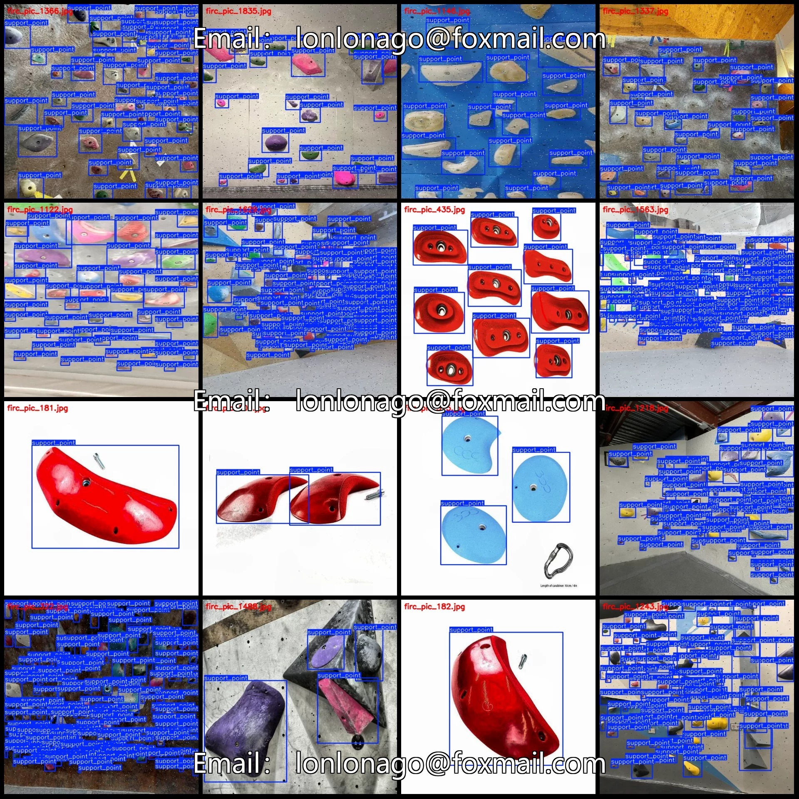
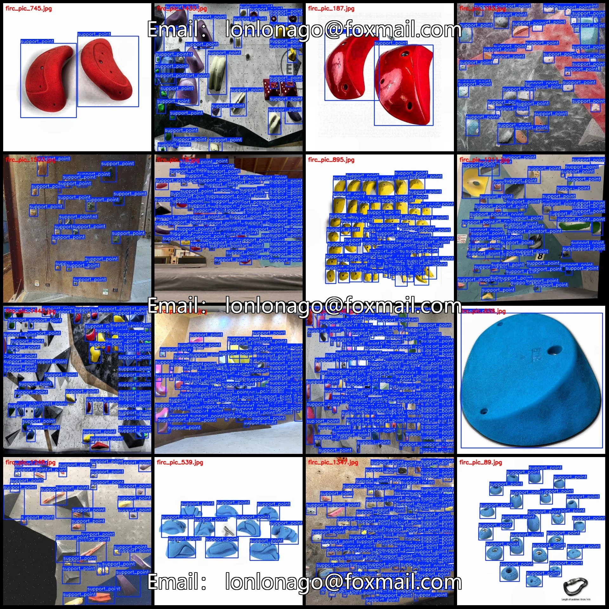
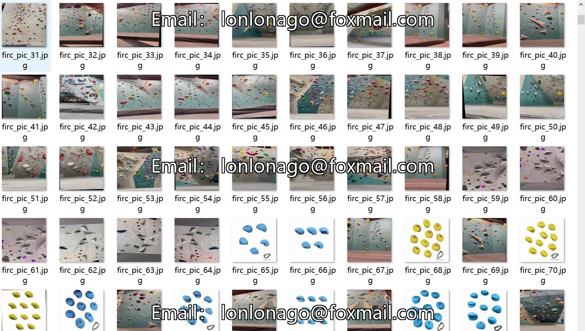
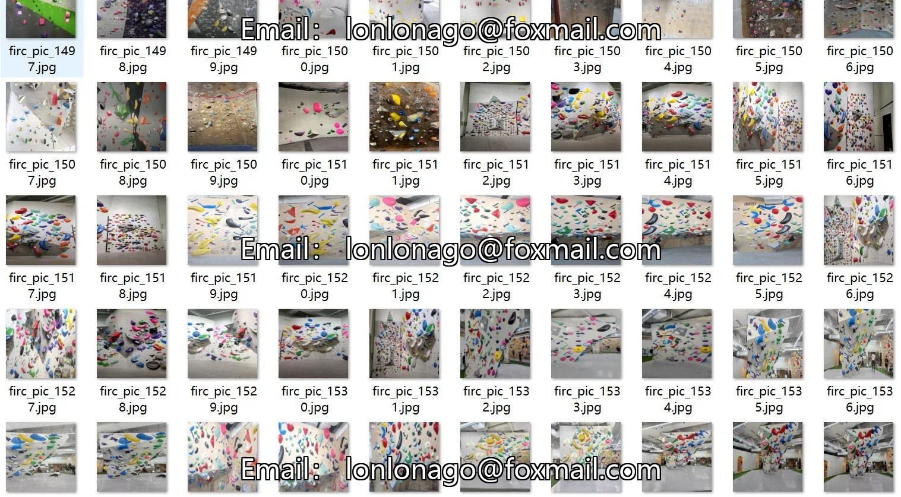
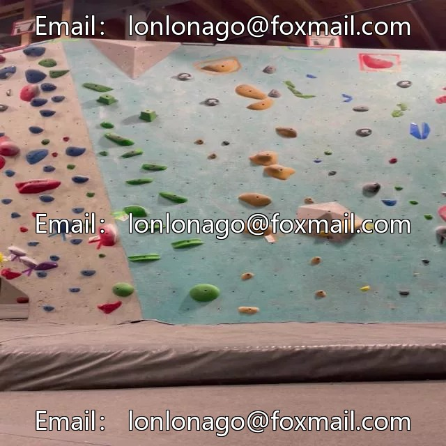

# Indoor rock climbing gym anchor detection dataset VOC+YOLO format 1859 images 1

## Body

1. Dataset Description:
The indoor rock climbing wall anchor detection dataset is in the format of VOC+YOLO, comprising 1859 images with 1 category.

2. Reminder: Due to the dataset's replicability, please confirm compliance with requirements before purchasing.

3. Dataset Format: Pascal VOC format + YOLO format (excluding split paths in txt files, only including jpg images and corresponding VOC format xml files and yolo format txt files).

4. Number of Images (JPG File Count): 1859

5. Number of Annotations (XML File Count): 1859

6. Number of Annotations (TXT File Count): 1859

7. Number of Annotation Categories: 1

8. Annotation Category Names: ["support_point"]

Each category has been labeled with boxes and their respective image counts.

Support Points: 81,595, occupying 1,859 images
Total Points: 81,595
Image Resolution: 640x640
Labeling Tool: labelImg
Labeling Rules: Draw a rectangle around the category.
Important Notice: The dataset does not have separate training, validation, and test sets; you need to partition them yourself.
Special Remark: This dataset does not guarantee the accuracy of the trained models or weight files.

## Images

## Payment

Here is a pay link on Stripe ( https://buy.stripe.com/3cs8yP7sY87d0vu9AB ). Please contact me lonlonago@foxmail.com after funding $89, and I will send you a complete data files , thank you!

